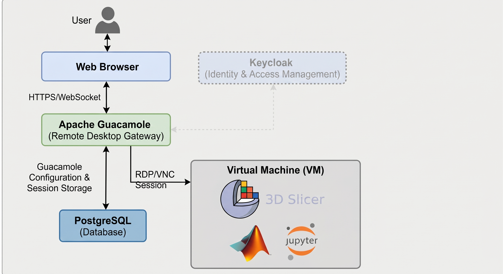

# Secure Remote Desktop

This tutorial walks through the deployment of a local **Secure Remote Desktop (SRD)**
stack using Docker Compose. The stack is defined under `https://github.com/NBISweden/aida-datahub-docs/tree/main/docs/dsp/examples/secure-remote-desktop/`.

By default the stack uses **Guacamole database authentication**. Admin
credentials are set in `.env` as `GUACAMOLE_ADMIN_USERNAME` /
`GUACAMOLE_ADMIN_PASSWORD` (defaults `guacadmin` / `guacadmin`). OpenID Connect
(any OIDC provider) and a local **Keycloak** Compose profile are optional.

## Topics

In this example you will:

1. Understand each Compose service and how they connect.
2. Choose (or swap) the remote desktop container image.
3. Configure `.env` and start the stack.
4. Sign in to Guacamole, open a remote desktop, and move files with Guacamole
   SFTP (drag and drop).
5. Optionally connect a generic OIDC provider (or the optional Keycloak
   profile).
6. Add Guacamole connections and users with the helper scripts in the
   `secure-remote-desktop/` directory.

## Prerequisites

This example assumes Docker Engine with Compose v2 and basic familiarity with
browsers, RDP, and environment variables.

To install Docker Engine, including Compose, follow the instructions available at
[Docker Engine installation](https://docs.docker.com/engine/install/).

Additionally, DSP secure environments block connections by default.
However, DSP provides an inspecting http proxy that enables downloading software
and security updates from public repositories that are trusted by AIDA Data Hub.
DSP data science images are preconfigured to make transparent use of this proxy,
as demonstrated in this next step.

To configure the VM to use the DSP proxy, run the following command:

```remote
curl http://10.253.254.250/ | bash
```

If you want to inspect the script, you can run:

```remote
curl http://10.253.254.250/ > dspconfigscript
cat dspconfigscript
```

and then run:

```remote
bash dspconfigscript
```

## Instructions

### 1. Architecture: components and how Remote Desktop works



**Components (default stack):**

- **PostgreSQL**: Guacamole database: users, permissions, and connections.
- **guacamole-schema** / **guacamole-db-init**: One-shot: extracts and applies
  the Guacamole JDBC schema, then sets the admin user from
  `GUACAMOLE_ADMIN_USERNAME` / `GUACAMOLE_ADMIN_PASSWORD`.
- **guacd**: Guacamole daemon: speaks RDP (and related protocols); Guacamole
  proxies the browser session through it.
- **guacamole**: Web UI and gateway at `/remote-desktops`. By default uses
  database authentication (`EXTENSION_PRIORITY=*`).
- **remote-desktop-home-init**: One-shot: owns `remote-desktop-home` as uid/gid
  `1000` with mode `700` on `/home/ubuntu`.
- **remote-desktop**: Desktop container reached over RDP (default image
  `maiacloudai/ubuntu-rdp:1.0`). Receives RDP from guacd; SSH/SFTP on
  port `2022` for Guacamole file transfer. See
  [Remote desktop image](#2-remote-desktop-image).

**Optional (Compose profile `keycloak`):**

- **keycloak**: Sample identity provider. Hosts the `srd` realm and OpenID
  client used when you enable Guacamole OpenID against this Keycloak.
- **keycloak-init**: One-shot setup: creates realm `srd`, confidential client,
  groups mapper, and a demo user
  (defaults `admin@srd.dsp.se` / `admin`).

**End-to-end flow (default):**

1. You open Guacamole in a browser at `http://localhost:8081/remote-desktops/`.
2. You sign in with Guacamole database credentials
   (`GUACAMOLE_ADMIN_USERNAME` / `GUACAMOLE_ADMIN_PASSWORD`).
3. Guacamole loads your allowed connections from **PostgreSQL** and asks
   **guacd** to open an **RDP** session to the **remote-desktop** container.
4. **SFTP is enabled by default** on the Guacamole RDP connection, so you can
   drag and drop files from your local machine into the remote desktop
   through the Guacamole UI (files land under `/home/ubuntu` via SSH/SFTP on
   the desktop container).

### 2. Remote desktop image

The Compose service `remote-desktop` runs the GUI workspace that Guacamole
opens over RDP. This example uses:

```text
maiacloudai/ubuntu-rdp:1.0
```

That image is an Ubuntu desktop with XRDP, SSH/SFTP, and tools such as
**3D Slicer** and **LibreOffice**. Set it in `.env` as
`REMOTE_DESKTOP_IMAGE` (see `test.env`).

Any other container image can be used instead, as long as it exposes:

| Protocol | Container port | Role                                           |
| -------- | -------------- | ---------------------------------------------- |
| **RDP**  | `3389`         | Desktop session via guacd / Guacamole          |
| **SSH**  | `2022`         | SFTP for Guacamole drag-and-drop file transfer |

The Guacamole connection created by `add_connection.sh` expects those ports
on the Compose service hostname `remote-desktop`, with desktop login
`ubuntu` / `ubuntu` and home directory `/home/ubuntu` (adjust the script or
connection parameters if your image uses different credentials or paths).

To swap the image:

```env
REMOTE_DESKTOP_IMAGE=maiacloudai/ubuntu-rdp:1.0
# or e.g. myregistry.example.com/my-rdp-desktop:tag
```

Then recreate the service:

```bash
docker compose up -d --force-recreate remote-desktop
```

If you change RDP/SSH credentials or the SFTP root path, update the Guacamole
connection (or re-run `add_connection.sh` with matching parameters) so
Guacamole and SFTP still reach the desktop.

### 3. Variables configuration

Credentials and URLs live in `.env`. Change them **before the first
`docker compose up`** when possible.

One `test.env` example is available at [https://github.com/NBISweden/aida-datahub-docs/blob/main/docs/dsp/examples/secure-remote-desktop/test.env](https://github.com/NBISweden/aida-datahub-docs/blob/main/docs/dsp/examples/secure-remote-desktop/test.env).

To start from it, download it to your VM and rename it to `.env`:

```bash
ENV_URL=https://raw.githubusercontent.com/NBISweden/aida-datahub-docs/main
wget "$ENV_URL/docs/dsp/examples/secure-remote-desktop/test.env" -O .env
```

#### Full variable reference (default stack)

Variables that should be changed by users:

- `POSTGRES_DB`: Should be changed by users to set the Guacamole JDBC
  database name (default: `guacamole_db`)
- `POSTGRES_USER`: Should be changed by users to specify the database user
  Guacamole connects as (default: `guacamole_user`)
- `POSTGRES_PASSWORD`: Should be changed by users to specify the database
  password (default: `guacamole_password`)
- `GUACAMOLE_ADMIN_USERNAME`: Should be changed by users to set the
  Guacamole database admin username (default: `guacadmin`)
- `GUACAMOLE_ADMIN_PASSWORD`: Should be changed by users to set the
  Guacamole database admin password (default: `guacadmin`)

Other variables:

- `POSTGRES_PORT`: Host port for PostgreSQL (default `5432`)
- `GUACD_PORT`: Host port for guacd (default `4822`)
- `GUACAMOLE_HTTP_PORT`: Host port for Guacamole (default `8081`)
- `OPENID_ENABLED`: Enable Guacamole OpenID (`false` by default)
- `EXTENSION_PRIORITY`: Guacamole auth extension order (default `*`; use
  `openid,*` when OpenID is enabled)
- `REMOTE_DESKTOP_IMAGE`: Desktop container image (default
  `maiacloudai/ubuntu-rdp:1.0`)
- `REMOTE_DESKTOP_RDP_PORT`: Host port for direct RDP (default `3389`)
- `REMOTE_DESKTOP_SSH_PORT`: Host port for SSH/SFTP used by Guacamole file
  transfer (default `2022`)
- `REMOTE_DESKTOP_TZ`: Timezone inside the remote desktop (default `Etc/UTC`)

#### Default public URL (`localhost`)

```env
REMOTE_DESKTOP_URL=http://localhost:8081/remote-desktops/
```

### 4. Start the stack

From the `secure-remote-desktop` directory:

```bash
docker compose up -d
```

This starts PostgreSQL, guacd, Guacamole, and the remote desktop. Keycloak is
**not** started.

When the stack is up:

- **Guacamole**: <http://localhost:8081/remote-desktops/>
  Sign in with `GUACAMOLE_ADMIN_USERNAME` / `GUACAMOLE_ADMIN_PASSWORD`
- **Postgres**: `localhost:5432`
  `POSTGRES_USER` / `POSTGRES_PASSWORD`, DB `POSTGRES_DB`
- **Direct RDP**: `localhost:3389`
  OS user `ubuntu` / `ubuntu` (not the Guacamole account)
- **SSH/SFTP**: `localhost:2022`
  `ubuntu` / `ubuntu` (used by Guacamole SFTP)

### 5. First login: Guacamole → Remote Desktop

1. Open Guacamole at <http://localhost:8081/remote-desktops/> (adjust the port
   if you changed `GUACAMOLE_HTTP_PORT` in `.env`).
2. Sign in with **`GUACAMOLE_ADMIN_USERNAME` / `GUACAMOLE_ADMIN_PASSWORD`**
   (set by `guacamole-db-init` from `.env`).
3. Open the **Remote Desktop** connection (create one with
   `add_connection.sh` if none exists yet). Guacamole uses
   guacd → RDP → remote-desktop. If the desktop prompts for a local login,
   use **`ubuntu` / `ubuntu`**.

### 6. Optional: connect a generic OIDC provider

Guacamole’s OpenID extension works with any standards-compliant OIDC provider
(Keycloak, Azure AD / Entra ID, Google, Okta, Auth0, etc.). Database users must
still exist in Guacamole; the OIDC claim
(`OPENID_USERNAME_CLAIM_TYPE`, default `email`) must match the Guacamole
username.

#### In your IdP

1. Create a **confidential** OIDC client for Guacamole.
2. Set the redirect / callback URI to your Guacamole public URL, for example:
   `http://localhost:8081/remote-desktops/`
3. Note the **issuer**, **authorization**, and **JWKS** endpoints from the
   discovery document at
   `{issuer}/.well-known/openid-configuration`.
4. Note the client ID and client secret.

#### In `.env`

```env
OPENID_ENABLED=true
EXTENSION_PRIORITY=openid,*
OPENID_AUTHORIZATION_ENDPOINT=https://idp.example.com/.../protocol/openid-connect/auth
OPENID_JWKS_ENDPOINT=https://idp.example.com/.../protocol/openid-connect/certs
OPENID_ISSUER=https://idp.example.com/...
OPENID_CLIENT_ID=guacamole
OPENID_CLIENT_SECRET=change-me
OPENID_USERNAME_CLAIM_TYPE=email
OPENID_REDIRECT_URI=http://localhost:8081/remote-desktops/
OPENID_GROUPS_CLAIM_TYPE=groups
```

`OPENID_JWKS_ENDPOINT` is fetched by the Guacamole container, so use a URL
reachable from Docker (public HTTPS IdP, or a Compose service hostname).
`OPENID_AUTHORIZATION_ENDPOINT`, `OPENID_ISSUER`, and `OPENID_REDIRECT_URI`
must match what the **browser** sees.

Apply and recreate Guacamole:

```bash
docker compose up -d --force-recreate guacamole
```

Create a Guacamole user whose username equals the IdP claim (usually email),
then link connections. On DSP, clear proxy variables so `curl` reaches local
containers (see [helper scripts](#9-add-connections-and-users-with-helper-scripts)):

```bash
http_proxy= https_proxy= HTTP_PROXY= HTTPS_PROXY= all_proxy= ALL_PROXY= \
  EMAIL=user@example.com PASSWORD=secret ./add_user.sh
http_proxy= https_proxy= HTTP_PROXY= HTTPS_PROXY= all_proxy= ALL_PROXY= \
  USERNAME=user@example.com ./link_connection.sh
```

You can still fall back to database login (`guacadmin`) because
`EXTENSION_PRIORITY=openid,*` keeps other auth methods available.

#### OpenID variable reference

- `OPENID_AUTHORIZATION_ENDPOINT`: Browser-facing authorization URL
- `OPENID_JWKS_ENDPOINT`: JWKS URL Guacamole uses to verify tokens
- `OPENID_ISSUER`: Issuer claim Guacamole expects (must match the IdP)
- `OPENID_CLIENT_ID`: OIDC client ID
- `OPENID_CLIENT_SECRET`: Confidential client secret
- `OPENID_USERNAME_CLAIM_TYPE`: Claim used as Guacamole username (default
  `email`)
- `OPENID_REDIRECT_URI`: Post-login return URL (Guacamole public URL +
  `/remote-desktops/`)
- `OPENID_GROUPS_CLAIM_TYPE`: Groups claim (default `groups`)

### 7. Optional: local Keycloak profile

To run the bundled Keycloak as a sample IdP:

```bash
# Uncomment / set the Keycloak + OPENID_* block in .env (see test.env), then:
docker compose --profile keycloak up -d
docker compose up -d --force-recreate guacamole
```

Keycloak-related variables:

- `KEYCLOAK_ADMIN`: Bootstrap admin for Keycloak **master** realm (default: `admin`)
- `KEYCLOAK_ADMIN_PASSWORD`: Password for that bootstrap admin (default: `admin`)
- `KEYCLOAK_HTTP_PORT`: Host port for Keycloak (default `8080`)
- `USER_EMAIL`: Demo user created by `keycloak-init`; also used as Guacamole
  username when matching the email claim
- `USER_PASSWORD`: Password for that demo user

When the profile is up:

- **Keycloak admin**: <http://localhost:8080/admin>
  `KEYCLOAK_ADMIN` / `KEYCLOAK_ADMIN_PASSWORD`
- Guacamole redirects to Keycloak (`srd` realm) when OpenID is enabled
- Demo IdP user defaults: `admin@srd.dsp.se` / `admin`

Example OpenID settings for the bundled Keycloak:

```env
OPENID_ENABLED=true
EXTENSION_PRIORITY=openid,*
OPENID_CLIENT_ID=srd
OPENID_CLIENT_SECRET=a7941129f1f1818072258721
OPENID_AUTHORIZATION_ENDPOINT=http://localhost:8080/realms/srd/protocol/openid-connect/auth
OPENID_JWKS_ENDPOINT=http://keycloak:8080/realms/srd/protocol/openid-connect/certs
OPENID_ISSUER=http://localhost:8080/realms/srd
OPENID_REDIRECT_URI=http://localhost:8081/remote-desktops/
OPENID_USERNAME_CLAIM_TYPE=email
USER_EMAIL=admin@srd.dsp.se
USER_PASSWORD=admin
```

Also create / link the matching Guacamole user:

```bash
EMAIL=admin@srd.dsp.se PASSWORD=admin USE_KEYCLOAK=true ./add_user.sh
USERNAME=admin@srd.dsp.se GRANT_ADMIN=true ./link_connection.sh
```

### 8. File sharing: Guacamole SFTP drag and drop

#### Guacamole SFTP (drag and drop into the desktop)

The RDP connection is configured with **`enable-sftp: true`**. Guacamole opens
a parallel SFTP channel to the remote desktop (`sftp-hostname` /
`REMOTE_DESKTOP_SSH_PORT`, user `ubuntu`) with root directory `/home/ubuntu`.

In the Guacamole session you can drag and drop files from your local machine
into the remote desktop; they appear under the user’s home directory without a
separate SFTP client.

### 9. Add connections and users with helper scripts

The `secure-remote-desktop/` directory includes shell helpers that talk to the
Guacamole REST API. They default to `GUACAMOLE_ADMIN_USERNAME` /
`GUACAMOLE_ADMIN_PASSWORD` (or `guacadmin` / `guacadmin`) and URLs for a local
Compose stack. Adjust `GUACAMOLE_URL`, credentials, emails, and connection
names as needed.
Requires `curl` and `jq`:

```bash
sudo apt-get install curl jq
```

Run them from a machine that can reach Guacamole, typically after
`docker compose up -d`.

On DSP VMs the inspecting HTTP proxy is usually set in the environment. Clear
those proxy variables when calling the helpers so `curl` talks to local
containers (`localhost`) directly instead of being redirected through the
proxy:

```bash
http_proxy= https_proxy= HTTP_PROXY= HTTPS_PROXY= all_proxy= ALL_PROXY= \
  ./add_connection.sh

http_proxy= https_proxy= HTTP_PROXY= HTTPS_PROXY= all_proxy= ALL_PROXY= \
  EMAIL=user@example.com PASSWORD=secret ./add_user.sh

http_proxy= https_proxy= HTTP_PROXY= HTTPS_PROXY= all_proxy= ALL_PROXY= \
  USERNAME=user@example.com ./link_connection.sh
```

#### Add an RDP connection (SFTP enabled)

Script: [`add_connection.sh`](secure-remote-desktop/add_connection.sh)

```bash
#!/bin/bash

GUACAMOLE_URL="http://localhost:8081/remote-desktops"
GUACAMOLE_DATA_SOURCE="postgresql"
GUACAMOLE_USERNAME="${GUACAMOLE_USERNAME:-${GUACAMOLE_ADMIN_USERNAME:-guacadmin}}"
GUACAMOLE_PASSWORD="${GUACAMOLE_PASSWORD:-${GUACAMOLE_ADMIN_PASSWORD:-guacadmin}}"
CONNECTION_NAME="Remote-Desktop"
SSH_PORT="2022"

authToken=$(curl -kX POST $GUACAMOLE_URL/api/tokens \
-H "Content-Type: application/x-www-form-urlencoded" \
-d "username=$GUACAMOLE_USERNAME&password=$GUACAMOLE_PASSWORD" | jq -r '.authToken')

curl -kX POST \
$GUACAMOLE_URL/api/session/data/$GUACAMOLE_DATA_SOURCE/connections?token=${authToken}\
     -H "Content-Type: application/json" \
     -d '{
           "parentIdentifier": "ROOT",
           "name": "'$CONNECTION_NAME'",
           "protocol": "rdp",
           "attributes": {},
           "parameters": {
             "hostname": "remote-desktop",
             "port": "3389",
             "username": "ubuntu",
             "password": "ubuntu",
             "security": "any",
             "ignore-cert": "true",
             "disable-copy": "true",
             "enable-sftp": "true",
             "sftp-hostname": "remote-desktop",
             "sftp-port": "'$SSH_PORT'",
             "sftp-username": "ubuntu",
             "sftp-password": "ubuntu",
             "sftp-root-directory": "/home/ubuntu",
             "sftp-directory": "/home/ubuntu"
           }
         }'
```

Note `enable-sftp: true` and the `sftp-*` parameters: that is what enables
browser drag-and-drop file transfer into the remote desktop.

#### Add a user (Guacamole; optional Keycloak)

Script: [`add_user.sh`](secure-remote-desktop/add_user.sh)

Creates a Guacamole database user by default. Set `USE_KEYCLOAK=true` only when
the Keycloak profile is running and you also want the user in Keycloak.

Prefix with the proxy-clearing assignments shown above when running on DSP.

```bash
EMAIL=user@example.com PASSWORD=secret ./add_user.sh

# With optional Keycloak:
EMAIL=user@srd.dsp.se PASSWORD=secret USE_KEYCLOAK=true ./add_user.sh
```

When OpenID is enabled, the Guacamole username must match the IdP claim
(default: email).

#### Link a connection to a user

Shared script: [`link_connection.sh`](secure-remote-desktop/link_connection.sh)

Grants `READ` on `CONNECTION_NAME` (default `Remote-Desktop`). Set
`GRANT_ADMIN=true` to also grant `ADMINISTER`.

Convenience wrappers:

- [`link_connection_to_admin.sh`](secure-remote-desktop/link_connection_to_admin.sh)
  — demo admin (`admin@srd.dsp.se`) with `GRANT_ADMIN=true`
- [`link_connection_to_user.sh`](secure-remote-desktop/link_connection_to_user.sh)
  — demo user (`user@srd.dsp.se`) with `READ` only

Prefix with the proxy-clearing assignments shown above when running on DSP.

```bash
# Default database admin already has access after creating the connection as guacadmin.
# For additional users:
USERNAME=user@example.com ./link_connection.sh

# OIDC / Keycloak demo accounts:
USERNAME=admin@srd.dsp.se GRANT_ADMIN=true ./link_connection.sh
USERNAME=user@srd.dsp.se ./link_connection.sh

# or
./link_connection_to_admin.sh
./link_connection_to_user.sh
```

Typical sequence for a new colleague (include the DSP proxy-clearing prefix):

```bash
http_proxy= https_proxy= HTTP_PROXY= HTTPS_PROXY= all_proxy= ALL_PROXY= \
  EMAIL=user@example.com PASSWORD=secret ./add_user.sh
http_proxy= https_proxy= HTTP_PROXY= HTTPS_PROXY= all_proxy= ALL_PROXY= \
  USERNAME=user@example.com ./link_connection.sh
```
